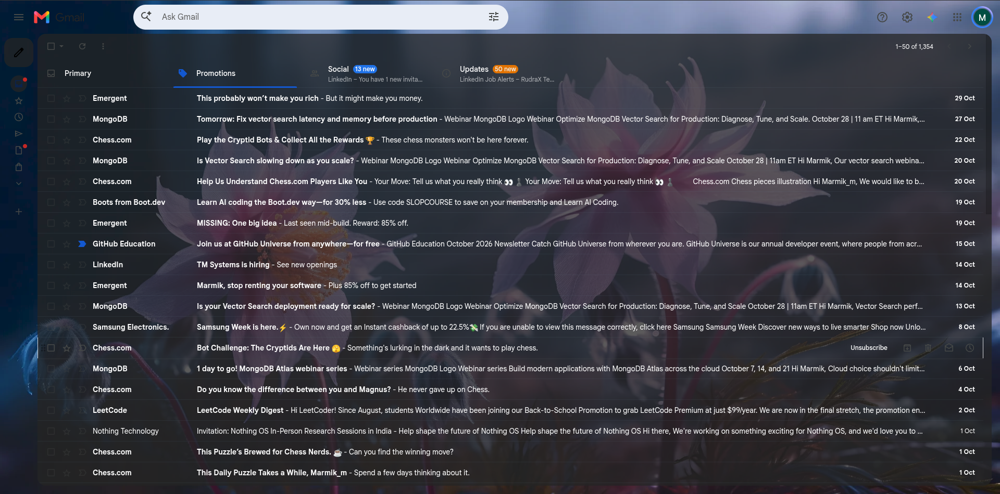
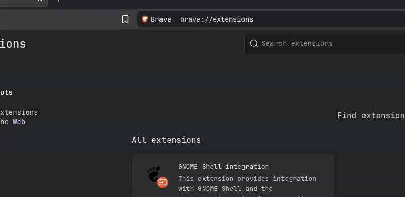

<div align="center">

# 🎨 Tinty

### *Tint your web, your way.*

**Browse documentation, blogs, and the internet in your favorite VS Code theme and wallpapers.**

[](https://developer.chrome.com/docs/extensions/mv3/intro/)
[](LICENSE)
[](#)
[](#)

<br />

<!-- Hero Preview Image -->
<p align="center">
  
</p>

</div>

---

## ✨ Features

* **🎨 Import Any VS Code Theme** — Drag & drop your favorite `.json` or `.vsix` theme file and read technical blogs, docs, and forums with authentic syntax highlighting and editor tones.
* **🖼️ Use Any Image as Background** — Turn any desktop wallpaper into an ambient browsing backdrop powered by an isolated hardware-accelerated layer with zero scroll lag.
* **🔮 Mix & Combine (Combo Mode)** — Layer your theme's code highlights and dark surface cards over a translucent wallpaper tint for the ultimate aesthetic setup.

---

## 📸 Showcase

<div align="center">

| Theme Only (Clean Dark Mode) | Theme + Wallpaper Combo |
|:---:|:---:|
|  |  |

| Extension Toolbar Popup | Theme Library & Settings |
|:---:|:---:|
|  |  |

</div>

---

## 🚀 Installation Guide

Tinty is 100% free, open-source, and runs on all modern Chromium browsers (**Google Chrome, Brave, Microsoft Edge, Opera, Vivaldi**).

> [!IMPORTANT]
> **Save the folder in a permanent location!**
> Do **NOT** install directly from a temporary `Downloads/` or `Desktop/` trash folder. Move the extracted folder to a permanent path like `~/Documents/extensions/tinty` or `C:\tools\tinty\`. If the folder is moved or deleted, your browser will automatically disable and remove the extension.

### Step-by-Step Instructions

1. **Download the Extension**:
   * Click the green **Code → Download ZIP** button above (or download `tinty-v0.7.0.zip` from [Releases](https://github.com/your-username/tinty/releases)).
   * Extract the ZIP file and move the folder to a permanent folder on your computer.

2. **Open the Extensions Page in Your Browser**:
   * **Chrome**: `chrome://extensions`
   * **Brave**: `brave://extensions`
   * **Edge**: `edge://extensions`

3. **Enable Developer Mode**:
   * Toggle the **Developer mode** switch in the top-right corner of the extensions page.

4. **Load the Extension**:
   * Click **Load unpacked** (top-left).
   * Select the folder containing `manifest.json`.

5. **Pin to Toolbar**:
   * Click the puzzle icon 🧩 in your browser toolbar and pin **Tinty** for quick one-click access!

<!-- Optional visual install walkthrough GIF -->
<!--
<p align="center">
  
</p>
-->

---

## ⚡ Quick Start: How to Export Your VS Code Theme

You can export and use whatever theme you are currently rocking in VS Code in less than 30 seconds:

<p align="center">
  
</p>

### Method 1: Export Current Theme directly from VS Code (Easiest)
1. Open VS Code.
2. Open the Command Palette: `Ctrl + Shift + P` (or `Cmd + Shift + P` on macOS).
3. Type and select: **`Developer: Generate Color Theme From Current Settings`**.
4. VS Code opens a new editor tab containing your complete, active theme JSON.
5. Save this file (`Ctrl + S` or `Cmd + S`) as `my-theme.json`.
6. In your browser, click **Tinty → Settings → Add a VS Code theme**, choose your saved file, and click **Save theme**!

### Method 2: From Installed Extensions Directory
If you have a theme installed from the VS Code Marketplace, its original `.json` file is already saved locally on your drive:
* **Linux / macOS**: `~/.vscode/extensions/<publisher.theme-name>/themes/`
* **Windows**: `C:\Users\<YourUsername>\.vscode\extensions\<publisher.theme-name>\themes\`

### Method 3: Use Built-in Presets
Don't have VS Code handy? Tinty comes bundled with **10 classic community presets**:
* Dracula, One Dark, Monokai, Nord, Gruvbox Dark, Night Owl, Tokyo Night, Catppuccin Mocha, Solarized Dark & Solarized Light.

---

## 🛠️ Developer Guide & Architecture

Tinty is built with pure, modern web standards — **zero dependencies, zero bundlers, and zero build steps**:

```
tinty/
├── manifest.json          # Manifest V3 extension configuration
├── content.js             # High-performance page recleaning & theme engine
├── theme-parser.js        # VS Code theme JSON parser & syntax token mapper
├── builtin-themes.js      # Bundled popular theme presets
├── popup.html / .js / .css# Quick toolbar toggle & theme switcher
├── options.html / .js / .css# Full library manager & offscreen canvas compressor
├── assets/                # Screenshots, banners, and preview assets
└── KNOWN_ISSUES.md        # Architecture decisions, benchmarks & solutions
```

### Key Technical Highlights:
* **Hardware-Accelerated Backdrop Layer**: Wallpapers render on an isolated `#vstr-backdrop-layer` directly on `document.documentElement`, keeping GPU compositor tile scrolling at 60–120 FPS.
* **Layout Thrashing Elimination**: The dynamic DOM observer uses two-phase batching (all `getComputedStyle` reads happen in Phase 1 before any inline style writes in Phase 2) scheduled via `requestIdleCallback`.
* **Client-Side Offscreen Compression**: Large 4K/8K images are downscaled to 1080p and compressed to WebP (quality 0.85) via an offscreen HTML5 canvas before storing in `chrome.storage.local`.
* **Privacy by Design**: Stored 100% locally on your machine. Zero telemetry, zero analytics, zero external network requests.

### Local Development:
1. Clone the repository:
   ```bash
   git clone https://github.com/your-username/tinty.git
   ```
2. Make your edits in `content.js`, `popup.js`, or `options.js`.
3. Go to `chrome://extensions` and click the refresh 🔄 icon on the Tinty card. Changes reflect instantly!

---

## 🤝 Contributing

Contributions, feedback, and issue reports are very welcome!
1. Fork the repository.
2. Create your feature branch (`git checkout -b feature/amazing-feature`).
3. Commit your changes (`git commit -m 'feat: add amazing feature'`).
4. Push to the branch (`git push origin feature/amazing-feature`).
5. Open a Pull Request.

---

## 📜 License

Distributed under the **MIT License**. See [`LICENSE`](LICENSE) for more information.
